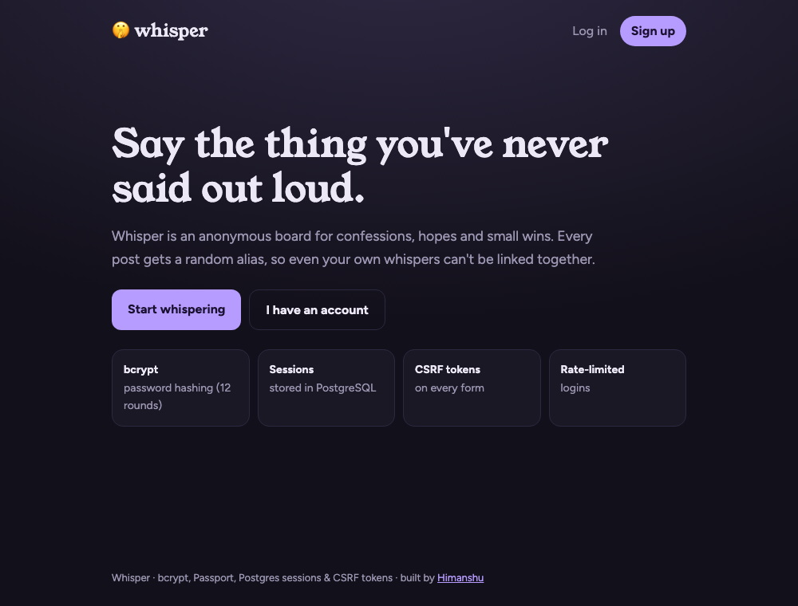

# 🤫 Whisper

> An anonymous confessions board with **production-style authentication**: bcrypt hashing, sessions stored in PostgreSQL, Passport.js (email/password and optional Google OAuth 2.0), CSRF tokens, rate-limited logins and authorisation enforced in SQL.

**🔗 Live demo:** https://whisper-rfuo.onrender.com/ *(free tier: the first visit after idle takes ~30–60s to wake up)*

[](https://github.com/himanshuuem/whisper/actions/workflows/test.yml)




## 🔐 Security, level by level

The course's *Secrets* project climbs through six authentication levels. Here's where Whisper ends up:

| Concern | Implementation |
|---|---|
| Password storage | **bcrypt**, 12 rounds (`bcryptjs`). The tests assert that the stored value is a `$2b$12$` hash. |
| User enumeration | The same error for an unknown email and a wrong password, plus a dummy-hash comparison so **timing** doesn't reveal registered emails |
| Password policy | 10–72 characters (bcrypt's input limit), at least one letter and one number |
| Sessions | `express-session` with **`connect-pg-simple`**: sessions live in Postgres and survive restarts. The cookie is `httpOnly`, `SameSite=Lax` and `Secure` in production. |
| Session fixation | Passport 0.7 regenerates the session on login |
| OAuth | **Google OAuth 2.0** via `passport-google-oauth20`, enabled only when credentials are set. It links to an existing account by email (`ON CONFLICT (lower(email))`). |
| CSRF | A synchroniser token stored in the session and checked with `timingSafeEqual` on every POST |
| Brute force | Per-IP rate limiting on login and registration, returning **429** with `Retry-After` |
| Authorisation | Delete is `DELETE ... WHERE id = $1 AND user_id = $2`, so you can only delete your own posts even with a forged request (tested) |
| Open redirects | The post-login `returnTo` only accepts same-site paths |
| Headers | A strict **CSP**, `nosniff` and `Referrer-Policy`. `x-powered-by` is disabled. |
| Secrets | `SESSION_SECRET` is **required** in production (the app refuses to boot without it) |

## ✨ Product features

- Post anonymous **whispers** tagged with a mood (🤫 confession, 🌱 hope, 🌧️ regret, 🏆 win, 🌑 fear) and filter the feed by mood.
- Each whisper gets a **per-post pseudonym** like "Jade Otter", so posts can't be linked to each other or to you.
- ♥ hearts (one per user, enforced by a composite primary key). Only you see the "you" badge on your own posts.
- An account page with **delete my account**, which cascades to your whispers and hearts.

## 🚀 Run Locally

```bash
git clone https://github.com/himanshuuem/whisper.git
cd whisper
npm install
cp .env.example .env     # set DATABASE_URL and SESSION_SECRET (Google keys optional)
npm run db:setup
npm run dev              # http://localhost:3000
DATABASE_URL=postgres://... npm test
```

**Google sign-in (optional):** create an OAuth client in the [Google Cloud Console](https://console.cloud.google.com/apis/credentials), add `${BASE_URL}/auth/google/callback` as an authorised redirect URI, and set `GOOGLE_CLIENT_ID` and `GOOGLE_CLIENT_SECRET`.

## 🧪 Tests

The suite drives the app like a browser, with a tiny cookie-jar agent that extracts CSRF tokens. It covers registration, the bcrypt hash format, login failures, case-insensitive email, CSRF rejection, posting, hearts, **cross-user delete returning 403**, logout and session persistence. CI runs it against `postgres:16`.

## ☁️ Deploy (free)

`render.yaml` provisions Postgres and the web service, generates `SESSION_SECRET` and sets `NODE_ENV=production`. Set `BASE_URL` to your Render URL if you enable Google.

## 📚 Origin

This is a rebuild of the **Secrets** authentication project (Levels 1–6, from plain text to bcrypt, sessions and OAuth) from [The Complete Web Development Bootcamp](https://www.udemy.com/course/the-complete-web-development-bootcamp/), hardened with CSRF, rate limiting, SQL-level authorisation and tests.

---

Made by [Himanshu](https://github.com/himanshuuem)
